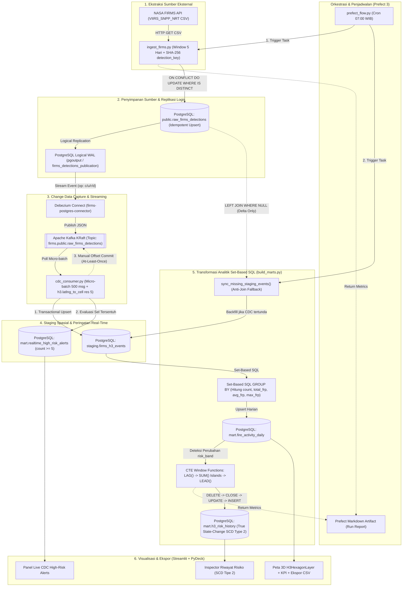

# NASA FIRMS Fire Activity — Geospatial CDC & SCD Tipe 2 Data Pipeline

Portofolio rekayasa data (*Data Engineering*) end-to-end yang mengekstraksi deteksi titik panas kebakaran hutan dari NASA FIRMS (VIIRS), menangkap perubahan data secara streaming melalui Change Data Capture (Debezium & Apache Kafka), mengindeks koordinat ke grid heksagonal Uber H3 (Resolusi 5), mengelola riwayat perubahan status risiko dengan SCD Tipe 2 murni (*State-Change Driven*), serta memvisualisasikannya ke dalam dashboard geospasial 3D interaktif.

[](http://localhost:8501)
[](https://www.python.org/downloads/)
[](https://www.postgresql.org/)
[](https://kafka.apache.org/)
[](https://www.prefect.io/)

---

## 🌟 Fitur Utama & Keunggulan Arsitektur

1. **Idempotent Ingestion & CDC Zero-Write Optimization**:
   * Menghasilkan hash SHA-256 komposit (`detection_key`) 7-elemen untuk deduplikasi.
   * Menggunakan klausa `ON CONFLICT DO UPDATE ... WHERE (...) IS DISTINCT FROM (...)` di PostgreSQL untuk mengeliminasi penulisan disk sia-sia dan mencegah event CDC palsu ke Kafka.
2. **Streaming CDC & H3 Spatial Indexing (At-Least-Once)**:
   * Replikasi logis via Debezium Connect (`pgoutput`) ke Kafka KRaft topic `firms.public.raw_firms_detections`.
   * Layanan `cdc-consumer` mengonsumsi *micro-batch* 500 event, memetakan koordinat ke heksagon Uber H3 resolusi 5 (~252 km²), memperbarui `staging.firms_h3_events`, dan mengevaluasi peringatan dini `mart.realtime_high_risk_alerts`.
   * Menggunakan trik `DELETE ... RETURNING acq_date, h3_index` dan query *pruning* untuk merefleksikan event hapus Debezium secara akurat.
   * Manual offset commit dieksekusi secara sinkron hanya setelah transaksi database berhasil (*At-Least-Once*).
3. **Set-Based SQL Window Functions & True SCD Tipe 2 (Gaps-and-Islands)**:
   * Mengelompokkan riwayat risiko hanya saat terjadi transisi status murni (*State-Change Driven*) menggunakan CTE `LAG()`, `SUM() OVER (...) AS island_id`, dan `LEAD()`.
   * Agregasi dibungkus dengan `ROUND(...::numeric, 4)::double precision` untuk mengeliminasi *floating-point drift* (`1e-15`) dari *parallel query workers* PostgreSQL.
   * Dilindungi oleh *session-level lock* `pg_advisory_xact_lock(20261028)` untuk mencegah konkurensi/deadlock.
4. **Interactive 3D Geospatial Dashboard & Dual-Mode (Live DB + Live Demo Snapshot)**:
   * Visualisasi heksagon 3D PyDeck Deck.gl (`H3HexagonLayer`) dengan pilihan tema basemap (`🌙 Dark Matter` / `☀️ Positron Light`).
   * Timeline Slider kronologis tersinkronisasi 3 arah dengan Kalender (`st.date_input`) dan tombol navigasi `◀ H-1` / `H+1 ▶`.
   * Mini-grafik tren harian Altair dan KPI Delta `H-1` (`delta_color="inverse"`).
   * **Dual-Mode Cloud Ready**: Berjalan langsung terhadap PostgreSQL lokal di Docker, atau beralih otomatis ke mode *compressed snapshot* (`dashboard/demo_data/*.csv.gz`, ~705 KB) saat dideploy publik ke Streamlit Community Cloud untuk CV.
5. **Orkestrasi Prefect 3 & Disaster Recovery**:
   * Jadwal Cron otomatis harian pukul 07.00 WIB dengan pembuatan laporan Markdown Artifact terintegrasi.
   * Skrip otomatis rotasi kredensial, backup kompresi (`pg_dump -Fc`), dan verifikasi pemulihan data terisolasi (`scripts/restore-check.ps1`).

---

## Alur data

`NASA FIRMS API → PostgreSQL (Raw) → Debezium/Kafka → Python CDC Consumer (H3 Indexing & Realtime Alerts) → Set-Based SQL Window Functions → Agregasi Harian & Riwayat SCD Tipe 2 → Streamlit Dashboard`



FIRMS diambil secara berkala. Debezium menangkap perubahan baris di PostgreSQL dari log replikasi logis (`pgoutput`); service `cdc-consumer` membaca topik Kafka secara *at-least-once*, menghitung indeks spasial H3 (`h3-py`), memperbarui tabel `staging.firms_h3_events` serta tabel peringatan dini `mart.realtime_high_risk_alerts`, lalu transformasi analitik membangun agregat harian dan transisi status SCD Tipe 2 murni (*State-Change Driven*) menggunakan SQL Window Functions (`LAG`, `SUM` Islands, `LEAD`).

## 1. Menjalankan PostgreSQL

Sebelum menjalankan Compose, buat kata sandi acak untuk PostgreSQL dan Debezium. Skrip mempertahankan MAP_KEY yang sudah tersimpan di `.env` dan tidak menampilkan kata sandi. Setelah itu, isi `FIRMS_MAP_KEY` di `.env` jika belum diisi:

```powershell
.\scripts\generate-local-secrets.ps1
notepad .env
docker compose up -d postgres
docker compose ps
```

PostgreSQL tersedia di `localhost:5434`. Database `fire_analytics` memakai pengguna `fire_user`; kata sandi disimpan di `.env` dan tidak dicatat di Git.

Port host PostgreSQL, Prefect, dashboard, dan Kafka Connect dibatasi ke `127.0.0.1`; akses hanya dari komputer yang menjalankan Docker. Ini konfigurasi demo lokal; deployment publik tetap perlu secret manager, autentikasi, dan HTTPS.

## Backup PostgreSQL

Buat backup manual ke `backups/`, validasi arsip, lalu uji pemulihan ke database baru yang terpisah:

```powershell
.\scripts\backup-postgres.ps1
.\scripts\restore-check.ps1
```

Folder `backups/` diabaikan Git. Skrip uji pemulihan meninggalkan database `restore_check_*` untuk diperiksa dan tidak menyentuh database aktif. Untuk produksi, salin backup ke penyimpanan terpisah dan uji pemulihan secara berkala.

## 2. Membuat tabel sumber FIRMS

```powershell
docker cp .\sql\001_create_raw_table.sql firms-postgres:/tmp/001_create_raw_table.sql
docker compose exec postgres psql -U fire_user -d fire_analytics -f /tmp/001_create_raw_table.sql
```

Skema tabel mengikuti format CSV VIIRS dari NASA. [Dokumentasi API FIRMS](https://firms.modaps.eosdis.nasa.gov/api/area/)

## 3. Mengambil data FIRMS

Jangan commit atau bagikan `.env`. Gunakan kata sandi yang berbeda untuk kedua akun.

```powershell
docker compose run --rm ingest
```

Sumber default `VIIRS_SNPP_NRT`; area kotak pembatas Indonesia `94,-11,142,7`; rentang terbaru default satu hari. API FIRMS menerima maksimal lima hari per permintaan. Untuk mengambil tanggal historis lebih panjang, isi `FIRMS_START_DATE` dan `FIRMS_END_DATE` di `.env` (inklusif); ingestor membagi rentang menjadi batch maksimal lima hari dan menggabungkan hasilnya. Contoh 30 hari sampai tanggal 27 Oktober 2026: `FIRMS_START_DATE=2026-09-28`, `FIRMS_END_DATE=2026-10-27`. [Aturan rentang tanggal API FIRMS](https://firms.modaps.eosdis.nasa.gov/api/area/).

## 4. Mengaktifkan CDC

Buat atau perbarui akun replikasi terbatas dan publication untuk tabel sumber. Pastikan `.env` memiliki `POSTGRES_PASSWORD` dan `DEBEZIUM_PASSWORD`, lalu jalankan:

```powershell
docker compose up -d postgres
.\scripts\rotate-db-passwords.ps1
docker compose up -d --build --force-recreate dashboard prefect-runner
```

Skrip memperbarui kata sandi pada database aktif dan memberi hak minimum yang dibutuhkan Debezium. Volume PostgreSQL tidak dihapus. Jika kontainer Kafka Connect sudah berjalan, daftarkan atau perbarui konfigurasi konektor memakai rahasia dari `.env`:

Jalankan Kafka dan Kafka Connect:

```powershell
docker compose up -d kafka connect
docker compose ps
```

Setelah Kafka Connect siap, daftarkan konektor PostgreSQL dan jalankan service `cdc-consumer`:

```powershell
.\scripts\register-connector.ps1
Invoke-RestMethod -Uri http://localhost:18083/connectors/firms-postgres-connector/status | ConvertTo-Json -Depth 5
docker compose up -d --build cdc-consumer
docker compose logs --tail 30 cdc-consumer
```

Untuk memproses seluruh antrian event Kafka yang ada secara sekali jalan (*one-shot*):

```powershell
docker compose run --rm ingest python cdc_consumer.py --once
```

Topik CDC untuk tabel sumber: `firms.public.raw_firms_detections`.

Validasi CDC berhasil: event Debezium (`op: c/u/r`) dikonsumsi oleh `cdc-consumer`, diperkaya dengan indeks spasial [h3-py](https://uber.github.io/h3-py/) (`latlng_to_cell`), dan disimpan ke `staging.firms_h3_events` serta `mart.realtime_high_risk_alerts` sebelum melakukan manual offset commit ke Kafka.

## 5. Membuat agregat H3 dan riwayat SCD Tipe 2

Bangun ulang image ingestor agar memasang pustaka H3, lalu hitung agregat harian per sel:

```powershell
docker compose build ingest
docker compose run --rm ingest python build_marts.py
```

Resolusi H3 default adalah 5. Tingkat risiko contoh memakai jumlah deteksi per sel per hari: `low` <5, `medium` 5–24, `high` >=25. Ini ambang demonstrasi untuk proyek, bukan tingkat bahaya kebakaran resmi.

Periksa hasil agregat:

```powershell
docker compose exec postgres psql -U fire_user -d fire_analytics -c "SELECT acq_date, h3_index, detection_count, round(total_frp::numeric, 1) AS total_frp, risk_band FROM mart.fire_activity_daily ORDER BY detection_count DESC LIMIT 10;"
```

Periksa versi status risiko yang masih berlaku:

```powershell
docker compose exec postgres psql -U fire_user -d fire_analytics -c "SELECT h3_index, risk_band, detection_count, source_date, valid_from, valid_to, is_current FROM mart.h3_risk_history WHERE is_current ORDER BY detection_count DESC LIMIT 10;"
```

## 6. Membuka dashboard peta H3

Bangun dan jalankan dashboard Streamlit:

```powershell
docker compose up -d --build dashboard
```

Buka `http://localhost:8501`. Dashboard menyajikan visualisasi heksagon 3D PyDeck, kartu metrik KPI dengan indikator perbandingan H-1, pemilih tema basemap (*Dark Matter* / *Positron Light*), Timeline Slider kronologis, Live CDC High-Risk Alerts, Inspector Riwayat SCD Tipe 2, dan unduhan CSV ber-BOM (`utf-8-sig`) untuk kompatibilitas Microsoft Excel.

### Mode Live Demo Cloud (Streamlit Community Cloud untuk CV)
Dashboard mendukung mode ganda (*Dual-Mode*):
* **Mode Docker Lokal**: Terhubung langsung secara real-time ke PostgreSQL `mart.*`.
* **Mode Cloud Snapshot**: Jika dijalankan di cloud tanpa koneksi database lokal (misalnya di [Streamlit Community Cloud](https://share.streamlit.io)), dashboard otomatis memuat snapshot terkompresi dari `dashboard/demo_data/*.csv.gz` (~705 KB) yang mencakup 30 hari data observasi penuh (252.196 deteksi VIIRS, 37.880 agregat H3 harian, dan 15.630 histori transisi SCD Tipe 2).

Untuk memperbarui snapshot data demo secara manual:
```powershell
docker compose run --rm ingest python scripts/export_demo_snapshot.py
```

## 7. Menjadwalkan pipeline dengan Prefect

Prefect mengatur flow ingest dan transformasi. Runner memakai jendela lima hari terbaru, lalu menjalankan transformasi H3/SCD Tipe 2; jadwal default pukul 07.00 WIB setiap hari. Server Prefect menyimpan deployment dan riwayat eksekusi pada volume `prefect_data`.

Bangun image dan jalankan server serta runner:

```powershell
docker compose up -d --build prefect-server prefect-runner
docker compose ps prefect-server prefect-runner
docker compose logs --tail 50 prefect-runner
```

Buka `http://localhost:4200`. Deployment `nasa-firms-daily-0700-wib` akan muncul setelah runner mendaftarkannya. Dari halaman deployment, jalankan satu flow secara manual untuk memastikan konfigurasi; setelah itu jadwal harian akan berjalan selama server dan runner aktif. Lihat status serta log run di antarmuka Prefect. Docker Desktop harus tetap aktif.

Skrip `scripts/run_pipeline.ps1` tetap tersedia untuk menjalankan pipeline manual dari Windows tanpa Prefect.

`mart.fire_activity_daily` menyimpan jumlah deteksi dan FRP per tanggal dan sel. `mart.h3_risk_history` membangun riwayat setiap H3 secara kronologis dari tanggal akuisisi: `valid_from` adalah awal tanggal observasi dan `valid_to` adalah tanggal observasi berikutnya untuk sel itu. Versi terbaru per sel ditandai `is_current=true`. Pemrosesan ulang bersifat idempoten dan menyelaraskan versi yang sudah ada, bukan menggandakannya.

## 8. Menyiapkan Lingkungan Pengembangan Lokal (Opsional: uv / venv)

Seluruh komponen utama berjalan di dalam Docker. Namun, jika Anda ingin menjalankan atau mengembangkan skrip Python secara langsung di host mesin lokal, buat virtual environment dengan `uv` (menggunakan Python 3.12 agar kompatibel dengan C-extension binary):

```powershell
uv venv --python 3.12
.\.venv\Scripts\Activate.ps1
uv pip install -r requirements.txt
```

File `requirements.txt` di root proyek mengunci versi pustaka (`altair`, `confluent-kafka`, `h3`, `pandas`, `prefect`, `psycopg`, `pydeck`, `requests`, `streamlit`).

---

### Hasil backfill 30 hari

Run lokal membaca 252.196 deteksi dan menghasilkan 37.880 agregat harian H3 pada resolusi 5. Tabel SCD Tipe 2 berisi 15.630 catatan transisi perubahan status risiko murni (*Gaps-and-Islands state changes*). Peringatan dini CDC mencatat 11.889 observasi berisiko medium/high. Angka ini adalah hasil run lokal dan berubah mengikuti data FIRMS.

## Tahapan Proyek

1. [x] Buat kerangka proyek dan repositori Git.
2. [x] Siapkan PostgreSQL dengan logical replication (`wal_level=logical`, `max_slot_wal_keep_size=512MB`).
3. [x] Buat tabel sumber VIIRS FIRMS dengan constraint koordinat geospasial.
4. [x] Buat ingestor dengan composite natural key SHA-256 dan evaluasi `IS DISTINCT FROM`.
5. [x] Siapkan Kafka KRaft 4.3.1 dan Debezium Connect 3.4.
6. [x] Jalankan ingestor dengan MAP_KEY (backfill 30 hari jendela 5-hari otomatis).
7. [x] Daftarkan konektor PostgreSQL dan pastikan status `RUNNING`.
8. [x] Buat stream consumer Kafka at-least-once dengan pemetaan spasial Uber H3 resolusi 5.
9. [x] Terapkan Set-Based SQL Window Functions (Gaps-and-Islands) untuk True State-Change SCD Tipe 2.
10. [x] Tangani PostgreSQL parallel float aggregation drift dengan `ROUND(...::numeric, 4)::double precision`.
11. [x] Bangun dashboard geospasial Streamlit 3D (PyDeck, theme selector, synchronized date controls, KPI delta H-1, export CSV ber-BOM).
12. [x] Siapkan mode Dual-Mode Cloud Snapshot untuk Live Demo CV (Streamlit Community Cloud).
13. [x] Jadwalkan pipeline dengan Prefect 3 (Cron 07:00 WIB, markdown run artifacts, auto-restart).
14. [x] Buat skrip disaster recovery (rotasi password aman, backup kompresi, verifikasi restore terisolasi).

## Catatan

Kredensial dalam konfigurasi hanya untuk demonstrasi lokal. Jangan gunakan di lingkungan publik atau produksi. Data Kafka pada konfigurasi demo ini tidak disimpan ke volume persisten; volume data PostgreSQL tetap persisten.


