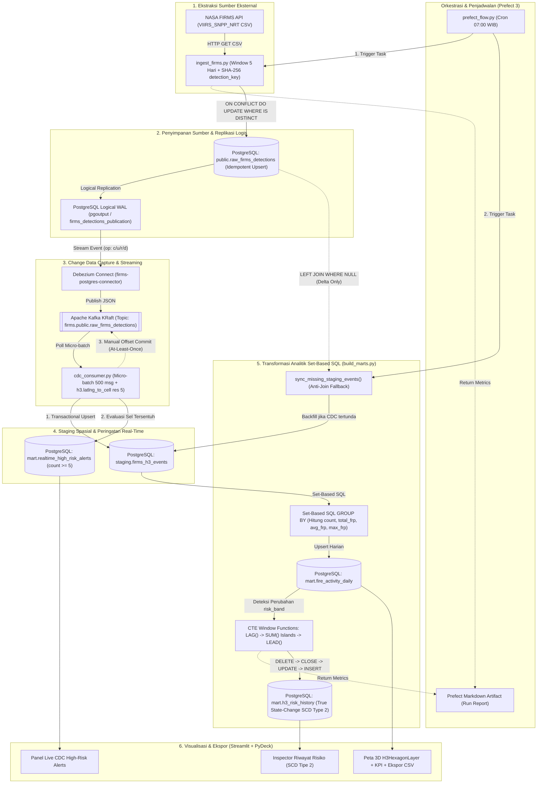

# FIRMS Fire Activity Data Pipeline

Portofolio rekayasa data yang mengolah deteksi kebakaran aktif dari NASA FIRMS, menangkap perubahan melalui CDC, menyimpan riwayat klasifikasi risiko dengan SCD Tipe 2, dan mengagregasikan aktivitas berdasarkan sel H3.

## Alur data

`NASA FIRMS API → PostgreSQL (Raw) → Debezium/Kafka → Python CDC Consumer (H3 Indexing & Realtime Alerts) → Set-Based SQL Window Functions → Agregasi Harian & Riwayat SCD Tipe 2 → Streamlit Dashboard`



FIRMS diambil secara berkala. Debezium menangkap perubahan baris di PostgreSQL dari log replikasi logis (`pgoutput`); service `cdc-consumer` membaca topik Kafka secara *at-least-once*, menghitung indeks spasial H3 (`h3-py`), memperbarui tabel `staging.firms_h3_events` serta tabel peringatan dini `mart.realtime_high_risk_alerts`, lalu transformasi analitik membangun agregat harian dan transisi status SCD Tipe 2 murni (*State-Change Driven*) menggunakan SQL Window Functions (`LAG`, `SUM` Islands, `LEAD`).

## 1. Menjalankan PostgreSQL

Sebelum menjalankan Compose, buat kata sandi acak untuk PostgreSQL dan Debezium. Skrip mempertahankan MAP_KEY yang sudah tersimpan di `.env` dan tidak menampilkan kata sandi. Setelah itu, isi `FIRMS_MAP_KEY` di `.env` jika belum diisi:

```powershell
.\scripts\generate-local-secrets.ps1
notepad .env
docker compose up -d postgres
docker compose ps
```

PostgreSQL tersedia di `localhost:5434`. Database `fire_analytics` memakai pengguna `fire_user`; kata sandi disimpan di `.env` dan tidak dicatat di Git.

Port host PostgreSQL, Prefect, dashboard, dan Kafka Connect dibatasi ke `127.0.0.1`; akses hanya dari komputer yang menjalankan Docker. Ini konfigurasi demo lokal; deployment publik tetap perlu secret manager, autentikasi, dan HTTPS.

## Backup PostgreSQL

Buat backup manual ke `backups/`, validasi arsip, lalu uji pemulihan ke database baru yang terpisah:

```powershell
.\scripts\backup-postgres.ps1
.\scripts\restore-check.ps1
```

Folder `backups/` diabaikan Git. Skrip uji pemulihan meninggalkan database `restore_check_*` untuk diperiksa dan tidak menyentuh database aktif. Untuk produksi, salin backup ke penyimpanan terpisah dan uji pemulihan secara berkala.

## 2. Membuat tabel sumber FIRMS

```powershell
docker cp .\sql\001_create_raw_table.sql firms-postgres:/tmp/001_create_raw_table.sql
docker compose exec postgres psql -U fire_user -d fire_analytics -f /tmp/001_create_raw_table.sql
```

Skema tabel mengikuti format CSV VIIRS dari NASA. [Dokumentasi API FIRMS](https://firms.modaps.eosdis.nasa.gov/api/area/)

## 3. Mengambil data FIRMS

Jangan commit atau bagikan `.env`. Gunakan kata sandi yang berbeda untuk kedua akun.

```powershell
docker compose run --rm ingest
```

Sumber default `VIIRS_SNPP_NRT`; area kotak pembatas Indonesia `94,-11,142,7`; rentang terbaru default satu hari. API FIRMS menerima maksimal lima hari per permintaan. Untuk mengambil tanggal historis lebih panjang, isi `FIRMS_START_DATE` dan `FIRMS_END_DATE` di `.env` (inklusif); ingestor membagi rentang menjadi batch maksimal lima hari dan menggabungkan hasilnya. Contoh 30 hari sampai tanggal 27 Oktober 2026: `FIRMS_START_DATE=2026-09-28`, `FIRMS_END_DATE=2026-10-27`. [Aturan rentang tanggal API FIRMS](https://firms.modaps.eosdis.nasa.gov/api/area/).

## 4. Mengaktifkan CDC

Buat atau perbarui akun replikasi terbatas dan publication untuk tabel sumber. Pastikan `.env` memiliki `POSTGRES_PASSWORD` dan `DEBEZIUM_PASSWORD`, lalu jalankan:

```powershell
docker compose up -d postgres
.\scripts\rotate-db-passwords.ps1
docker compose up -d --build --force-recreate dashboard prefect-runner
```

Skrip memperbarui kata sandi pada database aktif dan memberi hak minimum yang dibutuhkan Debezium. Volume PostgreSQL tidak dihapus. Jika kontainer Kafka Connect sudah berjalan, daftarkan atau perbarui konfigurasi konektor memakai rahasia dari `.env`:

Jalankan Kafka dan Kafka Connect:

```powershell
docker compose up -d kafka connect
docker compose ps
```

Setelah Kafka Connect siap, daftarkan konektor PostgreSQL dan jalankan service `cdc-consumer`:

```powershell
.\scripts\register-connector.ps1
Invoke-RestMethod -Uri http://localhost:18083/connectors/firms-postgres-connector/status | ConvertTo-Json -Depth 5
docker compose up -d --build cdc-consumer
docker compose logs --tail 30 cdc-consumer
```

Untuk memproses seluruh antrian event Kafka yang ada secara sekali jalan (*one-shot*):

```powershell
docker compose run --rm ingest python cdc_consumer.py --once
```

Topik CDC untuk tabel sumber: `firms.public.raw_firms_detections`.

Validasi CDC berhasil: event Debezium (`op: c/u/r`) dikonsumsi oleh `cdc-consumer`, diperkaya dengan indeks spasial [h3-py](https://uber.github.io/h3-py/) (`latlng_to_cell`), dan disimpan ke `staging.firms_h3_events` serta `mart.realtime_high_risk_alerts` sebelum melakukan manual offset commit ke Kafka.

## 5. Membuat agregat H3 dan riwayat SCD Tipe 2

Bangun ulang image ingestor agar memasang pustaka H3, lalu hitung agregat harian per sel:

```powershell
docker compose build ingest
docker compose run --rm ingest python build_marts.py
```

Resolusi H3 default adalah 5. Tingkat risiko contoh memakai jumlah deteksi per sel per hari: `low` <5, `medium` 5–24, `high` >=25. Ini ambang demonstrasi untuk proyek, bukan tingkat bahaya kebakaran resmi.

Periksa hasil agregat:

```powershell
docker compose exec postgres psql -U fire_user -d fire_analytics -c "SELECT acq_date, h3_index, detection_count, round(total_frp::numeric, 1) AS total_frp, risk_band FROM mart.fire_activity_daily ORDER BY detection_count DESC LIMIT 10;"
```

Periksa versi status risiko yang masih berlaku:

```powershell
docker compose exec postgres psql -U fire_user -d fire_analytics -c "SELECT h3_index, risk_band, detection_count, source_date, valid_from, valid_to, is_current FROM mart.h3_risk_history WHERE is_current ORDER BY detection_count DESC LIMIT 10;"
```

## 6. Membuka dashboard peta H3

Bangun dan jalankan dashboard Streamlit:

```powershell
docker compose up -d --build dashboard
```

Buka `http://localhost:8501`. Pilih tanggal dan kategori risiko untuk melihat sel H3 di peta, tabel, dan unduhan CSV. Klik atau arahkan kursor ke sel untuk melihat jumlah deteksi dan FRP. Tabel dan CSV memuat semua sel sesuai filter, termasuk koordinat pusat H3 (`cell_center_latitude`, `cell_center_longitude`). Koordinat tersebut adalah pusat sel agregasi, bukan lokasi asli tiap deteksi. Dashboard membaca `mart.fire_activity_daily`; refresh setelah menjalankan ulang transformasi.

## 7. Menjadwalkan pipeline dengan Prefect

Prefect mengatur flow ingest dan transformasi. Runner memakai jendela lima hari terbaru, lalu menjalankan transformasi H3/SCD Tipe 2; jadwal default pukul 07.00 WIB setiap hari. Server Prefect menyimpan deployment dan riwayat eksekusi pada volume `prefect_data`.

Bangun image dan jalankan server serta runner:

```powershell
docker compose up -d --build prefect-server prefect-runner
docker compose ps prefect-server prefect-runner
docker compose logs --tail 50 prefect-runner
```

Buka `http://localhost:4200`. Deployment `nasa-firms-daily-0700-wib` akan muncul setelah runner mendaftarkannya. Dari halaman deployment, jalankan satu flow secara manual untuk memastikan konfigurasi; setelah itu jadwal harian akan berjalan selama server dan runner aktif. Lihat status serta log run di antarmuka Prefect. Docker Desktop harus tetap aktif.

Skrip `scripts/run_pipeline.ps1` tetap tersedia untuk menjalankan pipeline manual dari Windows tanpa Prefect.

`mart.fire_activity_daily` menyimpan jumlah deteksi dan FRP per tanggal dan sel. `mart.h3_risk_history` membangun riwayat setiap H3 secara kronologis dari tanggal akuisisi: `valid_from` adalah awal tanggal observasi dan `valid_to` adalah tanggal observasi berikutnya untuk sel itu. Versi terbaru per sel ditandai `is_current=true`. Pemrosesan ulang bersifat idempoten dan menyelaraskan versi yang sudah ada, bukan menggandakannya.

### Hasil backfill 30 hari

Run lokal membaca 249.708 deteksi dan menghasilkan 35.861 agregat harian H3 pada resolusi 5. Tabel SCD Tipe 2 berisi 35.861 versi: 5.011 versi aktif dan 30.850 versi historis. Angka ini adalah hasil run lokal dan berubah mengikuti data FIRMS.

## Tahapan

1. [x] Buat kerangka proyek dan repositori Git.
2. [x] Siapkan PostgreSQL dengan logical replication.
3. [x] Buat tabel sumber VIIRS FIRMS.
4. [x] Buat ingestor dengan kunci deduplikasi.
5. [x] Siapkan Kafka dan Debezium Connect.
6. [x] Jalankan ingestor dengan MAP_KEY (14.848 baris diterima dan dimasukkan pada rentang lima hari).
7. [x] Jalankan Kafka dan Connect.
8. [x] Daftarkan konektor PostgreSQL dan pastikan status `RUNNING`.
9. [x] Verifikasi event CDC FIRMS muncul di Kafka.
10. [x] Hitung agregat H3 dan terapkan SCD Tipe 2 (35.861 agregat; 30.850 versi historis).
11. [x] Bangun dan jalankan kontainer dashboard pada port 8501; verifikasi tampilan peta masih menunggu.
12. [ ] Jalankan Prefect server/runner dan verifikasi flow serta jadwal harian.

## Catatan

Kredensial dalam konfigurasi hanya untuk demonstrasi lokal. Jangan gunakan di lingkungan publik atau produksi. Data Kafka pada konfigurasi demo ini tidak disimpan ke volume persisten; volume data PostgreSQL tetap persisten.


